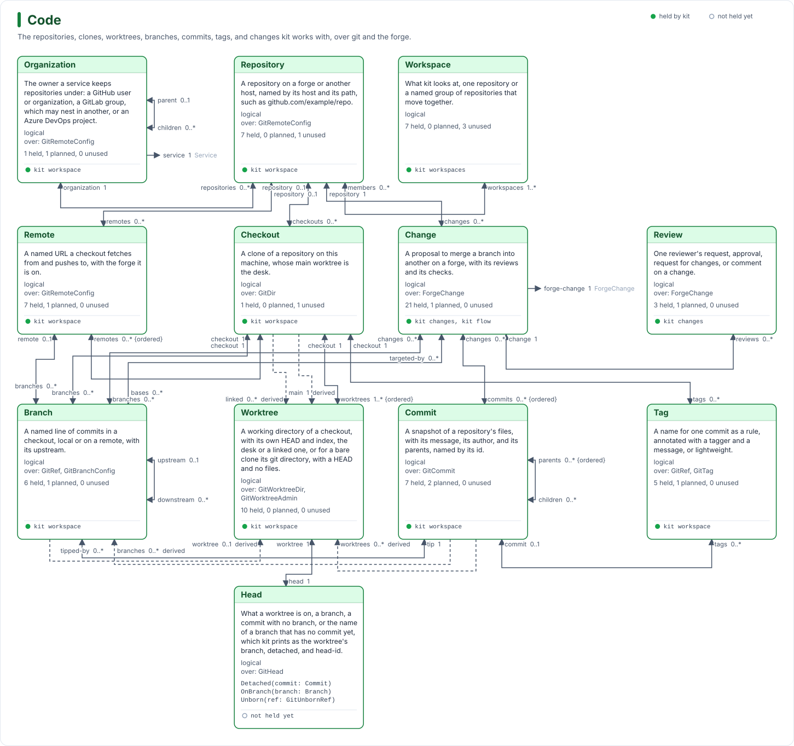

# Code

<!-- kit:generate page `kit model page --domain=code` -->
The repositories, clones, worktrees, branches, commits, tags, and changes kit works with, over git and the forge.

## Relations

| Relation | To | Arity | Ordered | Inverse | Means |
| --- | --- | --- | --- | --- | --- |
| Branch.changes | Change | 0..* |  | Change.branches | The changes whose head branch this is: this branch is the remote-tracking branch of the head branch, or a local branch whose upstream that remote-tracking branch is. |
| Branch.checkout | Checkout | 1 |  | Checkout.branches | The checkout whose refs hold the branch. |
| Branch.downstream | Branch | 0..* |  | Branch.upstream | The local branches whose upstream this branch is, which the branches stage prints as local. |
| Branch.remote | Remote | 0..1 |  | Remote.branches | For a remote-tracking branch, the remote it is a branch of, none for a local branch. |
| Branch.targeted-by | Change | 0..* |  | Change.bases | The changes that merge into this branch: this branch is the remote-tracking branch of their base branch, or a local branch whose upstream that remote-tracking branch is. |
| Branch.tip | Commit | 1 |  | Commit.tipped-by | The newest commit of the branch, which its ref names. |
| Branch.upstream | Branch | 0..1 |  | Branch.downstream | The branch a local branch pulls from and pushes to by default: a remote-tracking branch, or a local branch when its remote is . (this repository), none when no upstream is set or the upstream is gone. |
| Branch.worktree | Worktree | 0..1 |  | derived | derived: the worktree whose head is OnBranch with this branch. The worktree that has this local branch checked out, at most one, because git refuses to check a branch out in a second worktree unless forced, and none for a remote-tracking branch. |
| Change.bases | Branch | 0..* |  | Branch.targeted-by | The branch the change merges into as each checkout of this machine holds it: the remote-tracking branch of the base branch, and each local branch whose upstream that remote-tracking branch is. It is a branch of the change's own repository, which for a change from a fork is another repository than the fork, so a clone of the fork alone holds none. |
| Change.branches | Branch | 0..* |  | Branch.changes | The head branch as each checkout of this machine holds it: the remote-tracking branch of the head branch, and each local branch whose upstream that remote-tracking branch is, as kit work makes one. None when no checkout has fetched it, when the forge has deleted it, and for a change from a fork, whose head is a branch of the fork, another repository, which no remote here may reach. |
| Change.commits | Commit | 0..* | ordered | Commit.changes | The commits the change proposes, oldest first, which are a Commit here once a checkout fetches the head branch, none for a GitLab merge request made from an issue before its first push. |
| Change.forge-change | ForgeChange | 1 |  | ForgeChange.change | The forge's own record of the change, which kit reads. |
| Change.repository | Repository | 1 |  | Repository.changes | The repository the change merges into, which kit reads it from through the primary remote. |
| Change.reviews | Review | 0..* |  | Review.change | The reviews asked for and given on the change, one for each reviewer. |
| Checkout.branches | Branch | 0..* |  | Branch.checkout | Its local branches and its remote-tracking branches. |
| Checkout.linked | Worktree | 0..* |  | derived | derived: the worktrees among worktrees whose kind is linked. The worktrees git worktree add made, which kit work makes one per issue. |
| Checkout.main | Worktree | 1 |  | derived | derived: the worktree among worktrees whose kind is desk. The main worktree, the desk, which for a bare clone is its git directory, the first that git worktree list gives. |
| Checkout.remotes | Remote | 0..* | ordered | Remote.checkout | The remotes its configuration defines, the primary first, then the rest in the order git remote gives them. |
| Checkout.repository | Repository | 0..1 |  | Repository.checkouts | The repository its primary remote's URL names, none for a clone whose primary remote names no host. |
| Checkout.tags | Tag | 0..* |  | Tag.checkout | Its tags. |
| Checkout.worktrees | Worktree | 1..* | ordered | Worktree.checkout | Its worktrees, the main one first, then the linked ones in the order git worktree list gives them. A bare clone's main worktree is its git directory. |
| Commit.branches | Branch | 0..* |  | derived | derived: the local branches whose tip is this commit or reaches it through parents. The local branches that hold the commit, which the commits stage prints as branches. |
| Commit.changes | Change | 0..* |  | Change.commits | The changes that hold this commit. |
| Commit.children | Commit | 0..* |  | Commit.parents | The commits that name this one as a parent, among the commits this machine holds. |
| Commit.parents | Commit | 0..* | ordered | Commit.children | The commits this one follows, none for a root commit and two or more for a merge, the first merged into. |
| Commit.tags | Tag | 0..* |  | Tag.commit | The tags that point at this commit, an annotated tag through its tag object. |
| Commit.tipped-by | Branch | 0..* |  | Branch.tip | The branches whose tip this commit is, none for a commit inside a branch or on no branch. |
| Commit.worktrees | Worktree | 0..* |  | derived | derived: the worktrees whose HEAD resolves to this commit, on a branch whose tip it is or detached on it. The worktrees whose HEAD this commit is, which the commits stage prints as worktrees. |
| Head.worktree | Worktree | 1 |  | Worktree.head | The worktree whose HEAD this is. |
| Organization.children | Organization | 0..* |  | Organization.parent | The GitLab groups directly under this group. |
| Organization.parent | Organization | 0..1 |  | Organization.children | The GitLab group this group is under, none for a top-level group, a GitHub owner, and an Azure DevOps project. |
| Organization.repositories | Repository | 0..* |  | Repository.organization | The repositories kit knows of under this organization, which may be none, as for a parent group. |
| Organization.service | Service | 1 |  | Service.organizations | The service whose host the URL names. On Azure DevOps it is the Azure DevOps organization the URL names: the segment after dev.azure.com/ in an https URL, the segment after v3/ in an ssh.dev.azure.com URL, and the first label of the host in an \<org>.visualstudio.com URL. |
| Remote.branches | Branch | 0..* |  | Branch.remote | The remote-tracking branches the checkout holds for the remote, as the last fetch left them. |
| Remote.checkout | Checkout | 1 |  | Checkout.remotes | The checkout whose configuration defines the remote. |
| Remote.repository | Repository | 0..1 |  | Repository.remotes | The repository the remote's URL names, none for a URL that names no host, such as a path on this machine, or a path of one segment. |
| Repository.changes | Change | 0..* |  | Change.repository | The changes open on it or merged into it, as the forge reports them. |
| Repository.checkouts | Checkout | 0..* |  | Checkout.repository | Its clones on this machine under the workspace file's roots, each belonging to it by its primary remote, none for a repository that is not cloned. |
| Repository.organization | Organization | 1 |  | Organization.repositories | The owner its path names, the path without its last segment. |
| Repository.remotes | Remote | 0..* |  | Remote.repository | The remotes on this machine whose URL names the repository, in each of its checkouts, none for a member that is not cloned. |
| Repository.workspaces | Workspace | 1..* |  | Workspace.members | The workspaces that hold this repository as a member: the workspace of one repository, which the repository itself names, and each group it is a member of. |
| Review.change | Change | 1 |  | Change.reviews | The change the review is on. |
| Tag.checkout | Checkout | 1 |  | Checkout.tags | The checkout whose refs hold the tag. |
| Tag.commit | Commit | 0..1 |  | Commit.tags | The commit the tag finally points at, through any tag objects, none for a tag of a tree or a blob, which git allows, whose id kit prints in place of a commit's. |
| Workspace.members | Repository | 0..* |  | Repository.workspaces | The repositories the workspace holds: a group's members, none for a group whose entries all are excluded, and one for a workspace of one repository. |
| Worktree.checkout | Checkout | 1 |  | Checkout.worktrees | The checkout the worktree belongs to. |
| Worktree.head | Head | 1 |  | Head.worktree | What the worktree has checked out, a branch, a commit, or a branch that has no commit yet. |

## Entities

### Branch

A named line of commits in a checkout, local or on a remote, with its upstream.

Layer: logical over GitRef, GitBranchConfig

| Field | Type | Arity | Source | Status | Read by | Means |
| --- | --- | --- | --- | --- | --- | --- |
| default | Bool | 1 | derived | held | `workspace branches default` | derived from GitRemoteConfig.default-branch. Whether the branch is its remote's default branch, which kit prints as "default" or null. |
| kind | enum(remote, gone, local) | 0..1 | derived | held | `workspace branches kind` | derived from GitRef.kind. Which row of branches prints the branch: remote for a branch on a remote, gone for a local branch whose upstream is gone, and local for a local branch with no upstream on a remote. A local branch whose upstream exists has none, because its upstream's row names it. |
| name | Text | 1 | derived | held | `workspace branches branch` | derived from GitRef.branch. The branch's name, without refs/heads/ or the remote's name, as main. |
| reference | Text | 1 | derived | planned |  | derived from the repository's name and the branch's name. The branch's reference, its repository's reference and its name. |
| remote-name | Text | 0..1 | derived | held | `workspace branches remote` | derived from GitRef.remote. The name of the remote that has the branch, or for a gone branch the remote its configuration still names, none for a local branch with no upstream on a remote. |
| track | Int | 0..* | derived | held | `workspace branches upstream` | derived from what git for-each-ref %(upstream:track) prints for a local branch, as [ahead 3, behind 1]. For a local branch, how many commits it is ahead of its upstream, then how many behind, none for a branch with no upstream or a gone one. The branches stage prints the first local branch's on its upstream's row, and the worktrees stage prints it as track. |
| upstream-name | Text | 0..1 | derived | held | `workspace worktrees upstream` | derived from GitBranchConfig.upstream. For a local branch, its upstream's short name, as origin/main, which the worktrees stage prints for the branch a worktree is on. |

### Change

A proposal to merge a branch into another on a forge, with its reviews and its checks.

Layer: logical over ForgeChange

| Field | Type | Arity | Source | Status | Read by | Means |
| --- | --- | --- | --- | --- | --- | --- |
| age | Int | 1 | derived | held | `flow changes age` | derived from the forge's change, when it was opened. How many seconds ago the change was opened. |
| author | Text | 1 | derived | held | `flow changes author` | derived from the forge's change, the login of who opened it. The login of who opened the change, a bot's with [bot] after it. |
| branch-name | Text | 1 | derived | held | `flow changes branch` | derived from the forge's change, the name of its head branch. The name of the branch the change merges from, in the fork's repository for a change from a fork. |
| checks-failing | Text | 1 | derived | held | `flow changes checks.failing` | derived from the latest run of each check on the head commit, by its start. The name of the first check that failed, empty when none did. |
| checks-passed | Int | 1 | derived | held | `flow changes checks.passed` | derived from the latest run of each check on the head commit, by its start. How many checks passed. |
| checks-state | enum(NONE, FAILURE, PENDING, SUCCESS) | 1 | derived | held | `flow changes checks.state` | derived from the latest run of each check on the head commit, by its start. What the checks say together: NONE with no check, FAILURE when one failed, PENDING while one runs, and SUCCESS otherwise. |
| checks-took | Int | 0..1 | derived | held | `flow changes checks.took` | derived from the latest run of each check on the head commit, by its start. How many seconds the longest check took, or while one runs how long the oldest running one has waited, none where no run says. |
| checks-total | Int | 1 | derived | held | `flow changes checks.total` | derived from the latest run of each check on the head commit, by its start. How many checks the head commit has, a check being a name in one workflow for one event. |
| created | Time | 1 | derived | held | `flow changes createdAt` | derived from the forge's change, when it was opened. When the change was opened, as an ISO 8601 time. |
| fork | Text | 0..1 | derived | held | `flow changes fork` | derived from the forge's change, the owner of the repository its head branch is in when that is another repository. The owner of the fork the head branch lives in, a login on GitHub and a namespace's path on GitLab, none for a branch in the change's own repository and for a fork whose owner the forge does not name. |
| merged-at | Time | 0..1 | derived | held | `changes merged merged` | derived from the forge's change, when it was merged, or on Azure DevOps when it was completed. When the change was merged, in seconds since the epoch, none while it is open. |
| merged-by | Text | 0..1 | derived | held | `changes merged by` | derived from the forge's change, who merged it, or on Azure DevOps who completed it. The login of who merged the change, none while it is open and for a deleted account. |
| named | Text | 0..* | derived | held | `flow changes named` | derived from the forge's change, the closing keywords of its body. The references a closing keyword names in the body, each once, as AB#12 of Fixes AB#12, how a change closes an issue of a tracker the forge does not link by itself. |
| number | Int | 1 | derived | held | `flow changes number` | derived from the forge's change, GitHub's number, GitLab's iid, or Azure DevOps' pullRequestId. The change's number in its repository. |
| pushed-age | Int | 0..1 | derived | held | `flow changes pushed.age` | derived from the forge's change, the time of the latest push to its branch as far as the forge tells it cheaply. How many seconds ago the latest push to the branch was, on GitHub the head commit's time, none where the forge does not tell it. |
| pushed-by | Text | 0..1 | derived | held | `flow changes pushed.by` | derived from the forge's change, who pushed to its branch last as far as the forge tells it cheaply. The login of who pushed last, none where the forge does not name one. |
| ref | Text | 1 | derived | held | `flow changes ref` | derived from the forge's change, its number after the forge's mark. The number as the forge writes it in text, |
| reference | Text | 1 | derived | planned |  | derived from the repository's name and ref. The change's reference, as github.com/example/repo#3 on GitHub and gitlab.com/example/repo!3 on GitLab. |
| state | enum(draft, queued, conflicted, failing:gate, no-check, comments:open, blocked:approval, ready) | 1 | derived | held | `flow changes state` | derived from the forge's change, the first that holds of: a draft, a check pending, a conflict, a check failed, no check, an unresolved thread, and a review that blocks the merge. Where the change stands on its way to a merge, ready when nothing holds it back. |
| title | Text | 1 | derived | held | `flow changes title` | derived from the forge's change, its title. The change's title. |
| unresolved | Int | 1 | derived | held | `flow changes unresolved` | derived from the forge's change, its review threads. How many review threads on the change are unresolved. |
| url | Url | 0..1 | derived | held | `flow changes url` | derived from the forge's change, its page as the forge's tool reports it or the primary remote's URL gives it. The change's page on the forge, none where the forge's answer gives none. |

### Checkout

A clone of a repository on this machine, whose main worktree is the desk.

Layer: logical over GitDir

| Field | Type | Arity | Source | Status | Read by | Means |
| --- | --- | --- | --- | --- | --- | --- |
| bare | Bool | 1 | derived | unused |  | derived from GitDir.bare. Whether the clone has no working tree of its own, so its main worktree is its git directory, which kit does not print. |
| path | Path | 1 | derived | held | `workspace repos checkouts.*` | derived from GitDir.checkout. The folder of the clone, the top of its main worktree, or for a bare clone its git directory, GitDir.path. |

### Commit

A snapshot of a repository's files, with its message, its author, and its parents, named by its id.

Layer: logical over GitCommit

| Field | Type | Arity | Source | Status | Read by | Means |
| --- | --- | --- | --- | --- | --- | --- |
| age | Int | 1 | derived | held | `workspace commits age` | derived from GitSignature.time. How many seconds ago the commit was made, by its committer's time. |
| author | Text | 1 | derived | held | `workspace commits author` | derived from GitSignature.name. The name of who wrote the change. |
| id | Hash | 1 | derived | held | `workspace commits key` | derived from GitCommit.id. The commit's full id, which is its row's key. |
| issue | Text | 0..1 | derived | held | `workspace commits issue` | derived from GitMessage.subject. The |
| pushed | enum(pushed, local) | 1 | derived | held | `workspace commits pushed` | derived from whether git rev-list --max-count=1000 --branches --not --remotes, the commits local branches hold that no remote-tracking branch reaches, leaves the commit out. Whether a remote-tracking branch reaches the commit, pushed, or none does, local. Kit reads at most 1000 commits that no remote has, so a local commit past those prints as pushed. |
| reference | Text | 1 | derived | planned |  | derived from the repository's name, @, and the full id. The commit's reference, as github.com/example/repo@\<id>. |
| short-id | Hash | 1 | derived | held | `workspace commits commit` | derived from GitCommit.id. The id as git log %h abbreviates it. |
| signature | enum(good, bad, untrusted, expired, expired-key, revoked, uncheckable) | 0..1 | derived | planned |  | derived from GitObjectSignature.status. What checking the commit's signature finds, as git log %G? says it, none for a commit with no signature. |
| subject | Text | 1 | derived | held | `workspace commits subject` | derived from GitMessage.subject. The title of the commit's message. |

### Head

What a worktree is on, a branch, a commit with no branch, or the name of a branch that has no commit yet, which kit
prints as the worktree's branch, detached, and head-id.

Layer: logical over GitHead

| Variant | Field | Type |
| --- | --- | --- |
| Detached | commit | Commit |
| OnBranch | branch | Branch |
| Unborn | ref | GitUnbornRef |

### Organization

The owner a service keeps repositories under: a GitHub user or organization, a GitLab group, which may nest in
another, or an Azure DevOps project.

Layer: logical over GitRemoteConfig

| Field | Type | Arity | Source | Status | Read by | Means |
| --- | --- | --- | --- | --- | --- | --- |
| kind | enum(user, organization, group, project) | 1 | derived | planned |  | derived from the service's answer for the owner, a GitHub user or organization, a GitLab group, or an Azure DevOps project. What the service calls this owner: user or organization on GitHub, group on GitLab, and project on Azure DevOps. |
| name | Text | 1 | derived | held | `workspace repos organization` | derived from GitRemoteConfig.fetch-url. The path of the primary remote's URL after the host, without its last segment, as example for github.com/example/repo and group/sub for a GitLab subgroup, which every row of every stage prints as organization. On Azure DevOps that split gives org/proj/_git for `https://dev.azure.com/org/proj/_git/repo` and v3/org/proj for `git@ssh.dev.azure.com:v3/org/proj/repo`, two names for one project, which the Azure DevOps provider's own place splits into the organization and the project. |

### Remote

A named URL a checkout fetches from and pushes to, with the forge it is on.

Layer: logical over GitRemoteConfig

| Field | Type | Arity | Source | Status | Read by | Means |
| --- | --- | --- | --- | --- | --- | --- |
| branch-count | Int | 1 | derived | held | `workspace remotes branches` | derived from GitRef.remote. How many remote-tracking branches the checkout holds for the remote, its HEAD not counted. |
| default-branch | Text | 0..1 | derived | held | `workspace remotes default` | derived from GitRemoteConfig.default-branch. The name of the remote's default branch, none while no fetch has recorded the remote's HEAD. |
| forge | enum(github, gitlab, ado) | 0..1 | derived | held | `workspace remotes forge` | derived from GitRemoteConfig.fetch-url. The forge the remote is on, from the forge and forges settings of kit.yml, else the URL's host, else the runner's server or a forge tool's login, none when nothing names one. |
| name | Text | 1 | derived | held | `workspace remotes remote` | derived from GitRemoteConfig.name. The remote's name, as origin. |
| primary | Bool | 1 | derived | held | `workspace remotes primary` | derived from the primary setting in kit.yml, else origin. Whether this is the primary remote, which kit prints as "primary" or null. |
| push-url | Text | 0..1 | derived | held | `workspace remotes push` | derived from GitRemoteConfig.push-url. The URL a push goes to, none when it is the fetch URL. |
| reference | Text | 1 | derived | planned |  | derived from the repository's name and the remote's name. The remote's reference, its repository's reference and its name. |
| url | Text | 0..1 | derived | held | `workspace remotes url` | derived from GitRemoteConfig.fetch-url. The URL a fetch reads from, none for a remote with no URL. |

### Repository

A repository on a forge or another host, named by its host and its path, such as github.com/example/repo.

Layer: logical over GitRemoteConfig

| Field | Type | Arity | Source | Status | Read by | Means |
| --- | --- | --- | --- | --- | --- | --- |
| by | enum(fixed, given, here) | 1 | derived | held | `workspace repos by` | derived from how the workspace kit reads names the repository: a group's member, a repository given by --workspace=, or the repository kit runs in. Why kit reads this repository: fixed for a member of a group, given for a repository named, and here for the one kit runs in. |
| default-branch | Text | 0..1 | derived | unused |  | derived from GitRemoteConfig.default-branch. The branch the forge opens changes against unless told otherwise, the default branch of the desk's primary remote, none while no fetch has recorded it. Kit reads it to count what a worktree is ahead and behind, and prints it only as that remote's default. |
| desk | Path | 0..1 | derived | held | `workspace repos checkout` | derived from GitDir.checkout. The first of its checkouts on this machine, which is the one kit reads the repository from, none for a repository that is not cloned. |
| forge | enum(github, gitlab, ado) | 0..1 | derived | held | `workspace repos forge` | derived from the forge of the primary remote of the repository's desk, as modules/bash/forge.sh names it from kit.yml and the URL's host, else github for github.com and gitlab for gitlab.com. The forge the repository is on, none for a host no setting and no forge tool names. |
| host | Text | 1 | derived | held | `workspace repos host` | derived from GitRemoteConfig.fetch-url. The host part of the name, as github.com. |
| name | Text | 1 | derived | held | `workspace repos repository` | derived from GitRemoteConfig.fetch-url. The host and the path, the host in lower case and on GitHub and GitLab the path too, which is the repository's reference. A row of repos for a checkout that has no repository prints the checkout's folder in its place. On Azure DevOps the name keeps the URL's whole path, so one repository has two names, dev.azure.com/org/proj/_git/repo for its https URL and ssh.dev.azure.com/v3/org/proj/repo for its ssh URL. |
| path | Text | 1 | derived | held | `workspace repos path` | derived from GitRemoteConfig.fetch-url. The path part of the name, as example/repo, which is the organization's name, a slash, and the short name. |
| short-name | Text | 1 | derived | held | `workspace remotes repository` | derived from GitRemoteConfig.fetch-url. The last segment of the path, as repo, which every row of every stage prints as repository, except a row of repos, which prints the name. |

### Review

One reviewer's request, approval, request for changes, or comment on a change.

Layer: logical over ForgeChange

| Field | Type | Arity | Source | Status | Read by | Means |
| --- | --- | --- | --- | --- | --- | --- |
| at | Time | 0..1 | derived | held | `changes reviews at` | derived from the forge's change, when the reviewer answered. When the reviewer answered, in seconds since the epoch, none while asked and on Azure DevOps, which keeps no time for a vote. |
| login | Text | 1 | derived | held | `changes reviews login` | derived from the forge's change, a reviewer it asks or who reviewed it. The reviewer's login, or a team's slug for a team asked to review on GitHub. |
| reference | Text | 1 | derived | planned |  | derived from the change's reference and the reviewer's login. The review's reference, the change's reference with the reviewer. |
| state | enum(requested, approved, changes, commented) | 1 | derived | held | `changes reviews state` | derived from the forge's change, the reviewer's latest approval or request for changes on GitHub, an approval on GitLab, and a vote on Azure DevOps. Requested while the reviewer is asked and has not answered, else what the reviewer's latest review says. |

### Tag

A name for one commit as a rule, annotated with a tagger and a message, or lightweight.

Layer: logical over GitRef, GitTag

| Field | Type | Arity | Source | Status | Read by | Means |
| --- | --- | --- | --- | --- | --- | --- |
| age | Int | 0..1 | derived | held | `workspace tags age` | derived from GitSignature.time. How many seconds ago the tag was made, by its tagger's time, or for a lightweight tag its commit's committer time, as git for-each-ref %(creatordate) reads it. |
| kind | enum(annotated, lightweight) | 1 | derived | held | `workspace tags kind` | derived from GitRef.tag-kind. Whether the tag names a tag object or names an object, a commit as a rule, directly. |
| name | Text | 1 | derived | held | `workspace tags tag` | derived from GitRef.short-name. The tag's name, without refs/tags/, which is also its row's key. |
| reference | Text | 1 | derived | planned |  | derived from the repository's name and the tag's name. The tag's reference, its repository's reference and its name. |
| subject | Text | 0..1 | derived | held | `workspace tags subject` | derived from GitMessage.subject. The title of an annotated tag's message, or for a lightweight tag its commit's. |
| tagger | Text | 0..1 | derived | held | `workspace tags tagger` | derived from GitSignature.name. The name of who made an annotated tag, none for a lightweight tag. |

### Workspace

What kit looks at, one repository or a named group of repositories that move together.

Layer: logical

| Field | Type | Arity | Source | Status | Read by | Means |
| --- | --- | --- | --- | --- | --- | --- |
| exclude | Text | 0..* | stored | unused |  | The entries of a group's exclude, members kit takes back out, which kit reads only to find the members. |
| favorite | Bool | 1 | derived | held | `workspaces workspaces.*.favorite` | derived from whether the workspace file's favorites list names the workspace. Whether the workspace is among the favorites, which kit keeps at hand in the workspace menu. |
| kind | enum(group, repository) | 1 | derived | held | `workspaces --show kind` | derived from whether the name is a group's name in the workspace file, else a repository's host and path or URL. Whether the workspace is a group or one repository. |
| last-used | Bool | 1 | stored | unused |  | Whether the workspace is the last group used, which kit keeps in kit/workspaces/last under XDG_CACHE_HOME and starts on outside a repository. Kit prints no key for it, only start-reason last. |
| member-count | Int | 1 | derived | held | `workspaces workspaces.*.members` | derived from the number of member-names. How many members the group has. |
| member-names | Text | 0..* | derived | held | `workspaces workspaces.*.repos` | derived from the repos entries, each spelled as a member, once, in the file's order, without those exclude names. The group's members by their host and path, the names the members relation stands for. |
| name | Text | 1 | stored | held | `workspaces workspaces.*.name` | A group's name, a key of the workspace file's workspaces, or a repository's host and path for a workspace of one repository. The listing of kit workspaces --json holds the groups only, and the --show and --current forms print the name of a workspace of one repository. |
| recent-desks | Path | 0..* | stored | held | `workspaces --current recent.*.checkout` | For a workspace of one repository, the desks kit keeps among the recent, one for each clone of the repository opened by its folder, newest first, as kit stores them in kit/workspaces/recent under XDG_CACHE_HOME, the ten opened last of every repository, and prints those whose working tree is there. |
| repos | Text | 0..* | stored | unused |  | The entries of a group's repos, in the workspace file's order, each a member, a git URL, or a pattern of members, which kit reads only to find the members. |
| start-reason | enum(given, repository, last) | 0..1 | derived | held | `workspaces --current why` | derived from the workspace kit workspaces --current settles on: one given by --workspace=, the repository kit runs in, or the last group used. Why kit starts on this workspace where it runs, none for a workspace kit does not start on. When kit starts on no workspace, the --current form prints why as none, or as given for --workspace=none, beside kind none. |

### Worktree

A working directory of a checkout, with its own HEAD and index, the desk or a linked one, or for a bare clone its git
directory, with a HEAD and no files.

Layer: logical over GitWorktreeDir, GitWorktreeAdmin

| Field | Type | Arity | Source | Status | Read by | Means |
| --- | --- | --- | --- | --- | --- | --- |
| base | Int | 0..* | derived | held | `workspace worktrees base` | derived from git rev-list --left-right --count of the primary remote's default branch and HEAD, run in the worktree. How many commits HEAD is ahead of the primary remote's default branch, then how many behind, none while no fetch has recorded that branch. |
| branch | Text | 0..1 | derived | held | `workspace worktrees branch` | derived from GitRef.branch. The name of the branch its HEAD names, an unborn one's from GitUnbornRef.short-name, none when its HEAD is detached and for a bare clone's main worktree, whose branch git worktree list --porcelain does not print. |
| changed | Int | 0..1 | derived | held | `workspace worktrees changes` | derived from the changed and unmerged lines of git status --porcelain=v2, run in the worktree. How many paths are changed, staged or not, none where git status cannot run there. |
| detached | Bool | 1 | derived | held | `workspace worktrees detached` | derived from whether git worktree list --porcelain prints detached for the worktree, its GitHead being Detached. Whether its HEAD names a commit in place of a branch, which kit prints as "detached" or null. |
| head-id | Hash | 0..1 | derived | held | `workspace worktrees head` | derived from GitCommit.id. The first eight digits of the HEAD line git worktree list --porcelain prints, the id of the commit its HEAD resolves to, and 00000000 on an unborn branch, where git prints an id of zeros. None for a worktree with no HEAD line: a bare clone's main worktree, whose HEAD git worktree list --porcelain does not print. |
| kind | enum(desk, linked) | 1 | derived | held | `workspace worktrees kind` | derived from GitWorktreeDir.main. Whether the worktree is the checkout's main one, the desk, or a linked one. |
| locked | Bool | 1 | derived | held | `workspace worktrees locked` | derived from GitWorktreeAdmin.locked. Whether git worktree lock keeps it from being pruned, moved, or removed, which kit prints as "locked" or null. |
| path | Path | 1 | derived | held | `workspace worktrees path` | derived from GitWorktreeDir.worktree-path. The folder of the worktree, a bare clone's git directory for its main one, which is also its row's key. |
| prunable | Bool | 1 | derived | held | `workspace worktrees prunable` | derived from GitWorktreeAdmin.prunable. Whether git worktree prune would remove it, which kit prints as "prunable" or null. |
| untracked | Int | 0..1 | derived | held | `workspace worktrees untracked` | derived from the untracked lines of git status --porcelain=v2, run in the worktree. How many paths are untracked, none where git status cannot run there. |
<!-- kit:end page -->
