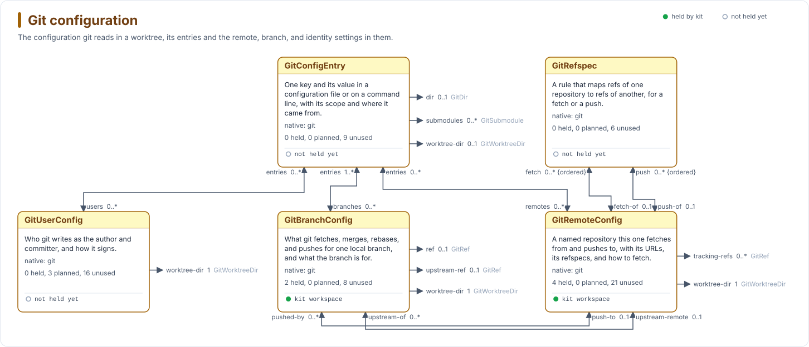

# Git configuration

<!-- kit:generate page `kit model page --domain=git-config` -->
The configuration git reads in a worktree, its entries and the remote, branch, and identity settings in them.

## Relations

| Relation | To | Arity | Ordered | Inverse | Means |
| --- | --- | --- | --- | --- | --- |
| GitBranchConfig.entries | GitConfigEntry | 1..* |  | GitConfigEntry.branches | The entries of the worktree's git config answer whose key is in the branch.\<name> section, from every scope that applies to that worktree: system, global, local, and worktree, with what its includes bring. |
| GitBranchConfig.push-to | GitRemoteConfig | 0..1 |  | GitRemoteConfig.pushed-by | The remote that push-remote names, none when it is unset or a URL. |
| GitBranchConfig.ref | GitRef | 0..1 |  | GitRef.config | The branch refs/heads/\<name>, none while no such branch exists. |
| GitBranchConfig.upstream-ref | GitRef | 0..1 |  | GitRef.upstream-of | The ref that is the upstream: the remote-tracking branch the remote's fetch refspecs map merge to, or, when remote is . (this repository), the local ref merge names, as git rev-parse \<branch>@{u} resolves it, none when no such ref exists. |
| GitBranchConfig.upstream-remote | GitRemoteConfig | 0..1 |  | GitRemoteConfig.upstream-of | The remote that remote names, none when remote is unset, is ., or names no configured remote. |
| GitBranchConfig.worktree-dir | GitWorktreeDir | 1 |  | GitWorktreeDir.branch-configs | The worktree these settings are git config's answer in, from the entries of every scope that apply there: system, global, local, and worktree, with what their includes bring. |
| GitConfigEntry.branches | GitBranchConfig | 0..* |  | GitBranchConfig.entries | The branch settings, one a worktree, of each worktree's git config answer this entry is part of and whose branch.\<name> section holds it. |
| GitConfigEntry.dir | GitDir | 0..1 |  | GitDir.config | The repository whose own config file, or a file it includes, holds this entry, none for an entry of the system, global, worktree, or command scope. |
| GitConfigEntry.remotes | GitRemoteConfig | 0..* |  | GitRemoteConfig.entries | The remotes, one a worktree, of each worktree's git config answer this entry is part of and whose remote.\<name> section holds it. |
| GitConfigEntry.submodules | GitSubmodule | 0..* |  | GitSubmodule.entries | The submodules whose repository's .gitmodules or configuration this entry is part of and whose submodule.\<name> section holds it. |
| GitConfigEntry.users | GitUserConfig | 0..* |  | GitUserConfig.entries | The identity and signing settings, one a worktree, of each worktree's git config answer this entry is part of, for an entry of one of their keys. |
| GitConfigEntry.worktree-dir | GitWorktreeDir | 0..1 |  | GitWorktreeDir.config | The worktree's git directory whose config.worktree holds this entry, for an entry of the worktree scope. |
| GitRefspec.fetch-of | GitRemoteConfig | 0..1 |  | GitRemoteConfig.fetch | The remote whose remote.\<name>.fetch holds this refspec. |
| GitRefspec.push-of | GitRemoteConfig | 0..1 |  | GitRemoteConfig.push | The remote whose remote.\<name>.push holds this refspec. |
| GitRemoteConfig.entries | GitConfigEntry | 0..* |  | GitConfigEntry.remotes | The entries of the worktree's git config answer whose key is in the remote.\<name> section, from every scope that applies to that worktree: system, global, local, and worktree, with what its includes bring. |
| GitRemoteConfig.fetch | GitRefspec | 0..* | ordered | GitRefspec.fetch-of | The refspecs of remote.\<name>.fetch, in order, which a fetch with no refspec of its own uses. |
| GitRemoteConfig.push | GitRefspec | 0..* | ordered | GitRefspec.push-of | The refspecs of remote.\<name>.push, in order, which a push with no refspec of its own uses. |
| GitRemoteConfig.pushed-by | GitBranchConfig | 0..* |  | GitBranchConfig.push-to | The branches whose branch.\<branch>.pushRemote names this remote. |
| GitRemoteConfig.tracking-refs | GitRef | 0..* |  | GitRef.remote-config | The remote-tracking branches under refs/remotes/\<name>/. |
| GitRemoteConfig.upstream-of | GitBranchConfig | 0..* |  | GitBranchConfig.upstream-remote | The branches whose branch.\<branch>.remote names this remote. |
| GitRemoteConfig.worktree-dir | GitWorktreeDir | 1 |  | GitWorktreeDir.remote-configs | The worktree this remote is git config's answer in, from the entries of every scope that apply there: system, global, local, and worktree, with what their includes bring. |
| GitUserConfig.entries | GitConfigEntry | 0..* |  | GitConfigEntry.users | The entries of the worktree's git config answer whose key is one of these, from every scope that applies to that worktree: system, global, local, and worktree, with what its includes bring. |
| GitUserConfig.worktree-dir | GitWorktreeDir | 1 |  | GitWorktreeDir.user-config | The worktree these settings are git config's answer in, from the entries of every scope that apply there: system, global, local, and worktree, with what their includes bring. |

## Entities

### GitBranchConfig

What git fetches, merges, rebases, and pushes for one local branch, and what the branch is for.

Layer: native (git)

| Field | Type | Arity | Source | Status | Read by | Means |
| --- | --- | --- | --- | --- | --- | --- |
| delete-merged | Bool | 0..1 | stored | unused |  | Whether git branch --delete-merged may delete the branch, true unless set to false. |
| description | Text | 0..1 | stored | unused |  | What the branch is for, as git branch --edit-description writes it. |
| merge | Text | 0..* | stored | unused |  | The values of branch.\<name>.merge, each a ref on the remote, as refs/heads/main, more than one for an octopus merge. |
| merge-options | Text | 0..1 | stored | unused |  | The options of a merge into the branch, as git merge takes them. |
| name | Text | 1 | stored | unused |  | The subsection of branch.\<name>, the branch's name without refs/heads/. |
| other-keys | Text | 0..* ordered | stored | unused |  | Each key of the section git does not document, as name=value in order, such as the merge base an editor or a forge's command line records. |
| push-remote | Text | 0..1 | stored | unused |  | The value of branch.\<name>.pushRemote, a remote's name or a URL, which a push uses in place of remote. |
| rebase | enum(true, false, yes, no, on, off, 1, 0, merges, m, interactive, i) | 0..1 | stored | unused |  | The value as written: a boolean spelling for whether git pull rebases the branch in place of merging, merges or m to rebase keeping merge commits, and interactive or i to rebase interactively. |
| remote | Text | 0..1 | stored | held | `workspace branches remote` | The value of branch.\<name>.remote, the remote's name, or . for this repository, which kit prints for a branch whose upstream is gone. |
| upstream | Text | 0..1 | derived | held | `workspace worktrees upstream` | derived from the ref the remote's fetch refspecs map the first merge value to, short, as git status --porcelain=v2 --branch prints it on its branch.upstream line. The upstream branch, as origin/main, or the local branch's name when remote is . |

### GitConfigEntry

One key and its value in a configuration file or on a command line, with its scope and where it came from.

Layer: native (git)

| Field | Type | Arity | Source | Status | Read by | Means |
| --- | --- | --- | --- | --- | --- | --- |
| blob | Text | 0..1 | stored | unused |  | The blob that holds it, as --blob names it, such as HEAD:.gitmodules. |
| file | Path | 0..1 | stored | unused |  | The file that holds it, an included file for an entry under an include or includeIf section. |
| key | Text | 1 | stored | unused |  | The key, as section.subsection.name, which git prints with the section and the name in lower case and the subsection as written. |
| name | Text | 1 | derived | unused |  | derived from the key after its last dot. The variable's name, as url, which git matches without regard to case. |
| origin | enum(file, blob, standard input, command line) | 1 | stored | unused |  | The kind of place git read it from, as --show-origin prints before the colon. |
| scope | enum(system, global, local, worktree, command) | 1 | stored | unused |  | Which configuration it belongs to: the system's, the user's ~/.gitconfig or XDG file, the repository's config, a worktree's config.worktree, or the command's own, which also holds a file that --file or --blob names. |
| section | Text | 1 | derived | unused |  | derived from the key up to its first dot. The section, as remote, which git matches without regard to case. |
| subsection | Text | 0..1 | derived | unused |  | derived from the key between its first and its last dot. The subsection, as origin in remote.origin.url, which git matches by case. |
| value | Text | 0..1 | stored | unused |  | The value as written, none for a key written with no equals sign, which git reads as true. |

### GitRefspec

A rule that maps refs of one repository to refs of another, for a fetch or a push.

Layer: native (git)

| Field | Type | Arity | Source | Status | Read by | Means |
| --- | --- | --- | --- | --- | --- | --- |
| destination | Text | 0..1 | derived | unused |  | derived from the text after the colon. The refs it writes on the side the update goes to, none when there is no colon. |
| force | Bool | 1 | derived | unused |  | derived from whether the text starts with +. Whether the update goes ahead when it is not a fast-forward. |
| negative | Bool | 1 | derived | unused |  | derived from whether the text starts with ^. Whether the refspec leaves out the refs its source matches. |
| pattern | Bool | 1 | derived | unused |  | derived from whether the source holds a \*. Whether the refspec matches many refs, the \* in the destination standing for what the source's \* matched. |
| source | Text | 0..1 | derived | unused |  | derived from the text after any + or ^ and before the colon. The refs it matches on the side the update comes from, none for a push of :, the matching branches. |
| text | Text | 1 | stored | unused |  | The refspec as written, as +refs/heads/\*:refs/remotes/origin/\*. |

### GitRemoteConfig

A named repository this one fetches from and pushes to, with its URLs, its refspecs, and how to fetch.

Layer: native (git)

| Field | Type | Arity | Source | Status | Read by | Means |
| --- | --- | --- | --- | --- | --- | --- |
| advertised-as | Text | 0..1 | stored | unused |  | The name a server advertised the remote under, when git configured it as a promisor remote from that advice. |
| default-branch | Text | 0..1 | derived | held | `workspace remotes default` | derived from the ref the symbolic ref refs/remotes/\<name>/HEAD names, after refs/remotes/\<name>/, as git symbolic-ref prints it. The remote's default branch, as the symbolic ref that git clone and git remote set-head write records it, none while refs/remotes/\<name>/HEAD does not exist. |
| fetch-url | Text | 0..1 | derived | held | `workspace remotes url` | derived from the first url, rewritten by the longest url.\<base>.insteadOf that starts it, as git remote get-url prints it. The URL a fetch reads from. |
| follow-remote-head | Text | 0..1 | stored | unused |  | What a fetch does when the remote's HEAD differs from refs/remotes/\<name>/HEAD: create, always, warn, never, or warn-if-not-\<branch>, as fetch.followRemoteHEAD takes it. |
| mirror | Bool | 0..1 | stored | unused |  | Whether a push to the remote acts as git push --mirror. |
| name | Text | 1 | stored | held | `workspace remotes remote` | The subsection of remote.\<name>, as origin. |
| negotiation-include | Text | 0..* | stored | unused |  | The refs, ids, or patterns whose commits a fetch always advertises as haves. |
| negotiation-restrict | Text | 0..* | stored | unused |  | The refs or patterns whose commits alone a fetch advertises as haves, as --negotiation-restrict takes them. |
| other-keys | Text | 0..* ordered | stored | unused |  | Each key of the section git does not document, as name=value in order, such as one a tool records. |
| partial-clone-filter | Text | 0..1 | stored | unused |  | The object filter a fetch from this promisor remote applies, as --filter takes it. |
| promisor | Bool | 0..1 | stored | unused |  | Whether git fetches the objects a partial clone left out from this remote. |
| proxy | Text | 0..1 | stored | unused |  | The proxy for an HTTP, HTTPS, or FTP URL, an empty value turning proxying off. |
| proxy-auth-method | Text | 0..1 | stored | unused |  | How to authenticate to that proxy, as http.proxyAuthMethod takes it. |
| prune | Bool | 0..1 | stored | unused |  | Whether a fetch removes the remote-tracking branches whose branch the remote no longer has. |
| prune-tags | Bool | 0..1 | stored | unused |  | Whether a fetch that prunes also removes the local tags the remote no longer has. |
| push-url | Text | 0..1 | derived | held | `workspace remotes push` | derived from the first pushurl, else the first url rewritten by url.\<base>.pushInsteadOf or insteadOf, as git remote get-url --push prints it. The first URL a push goes to, which kit prints only when it differs from the fetch URL. |
| push-urls | Text | 0..* | stored | unused |  | The values of remote.\<name>.pushurl, as written, each of which a push goes to in place of the urls. |
| receive-pack | Text | 0..1 | stored | unused |  | The program a push runs on the remote's side, as git push --receive-pack names it. |
| server-options | Text | 0..* | stored | unused |  | The server options a fetch sends, as --server-option takes them, an empty value clearing those before it. |
| skip-default-update | Bool | 0..1 | stored | unused |  | A deprecated synonym of skip-fetch-all, the last of the two set winning. |
| skip-fetch-all | Bool | 0..1 | stored | unused |  | Whether git fetch --all, git remote update, and the prefetch of git maintenance leave the remote out. |
| tag-opt | enum(--no-tags, --tags) | 0..1 | stored | unused |  | Whether a fetch follows no tags, or fetches every tag, in place of the tags that point into what it fetches. |
| upload-pack | Text | 0..1 | stored | unused |  | The program a fetch runs on the remote's side, as git fetch-pack --upload-pack names it. |
| urls | Text | 0..* ordered | stored | unused |  | The values of remote.\<name>.url, as written, the first fetched from and all pushed to when no pushurl is set. |
| vcs | Text | 0..1 | stored | unused |  | The version control system the remote is, which git reaches through the git-remote-\<vcs> helper. |

### GitUserConfig

Who git writes as the author and committer, and how it signs.

Layer: native (git)

| Field | Type | Arity | Source | Status | Read by | Means |
| --- | --- | --- | --- | --- | --- | --- |
| author-email | Text | 0..1 | stored | unused |  | The value of author.email, which an author takes in place of user.email. |
| author-name | Text | 0..1 | stored | unused |  | The value of author.name, which an author takes in place of user.name. |
| commit-gpg-sign | Bool | 0..1 | stored | unused |  | The value of commit.gpgSign, whether git signs every commit, which kit reads only to warn when it is not. |
| committer-email | Text | 0..1 | stored | unused |  | The value of committer.email, which a committer takes in place of user.email. |
| committer-name | Text | 0..1 | stored | unused |  | The value of committer.name, which a committer takes in place of user.name. |
| email | Text | 0..1 | stored | planned |  | The value of user.email, the email of an author and a committer. |
| gpg-format | enum(openpgp, x509, ssh) | 0..1 | stored | unused |  | The value of gpg.format, the kind of signature git makes, openpgp when unset. |
| gpg-program | Text | 0..1 | stored | unused |  | The value of gpg.openpgp.program, or its older name gpg.program, the program that signs, gpg when unset. |
| min-trust-level | enum(undefined, never, marginal, fully, ultimate) | 0..1 | stored | unused |  | The value of gpg.minTrustLevel, the least trust a key needs for git to take its signature as good. |
| name | Text | 0..1 | stored | planned |  | The value of user.name, the name of an author and a committer. |
| signing-key | Text | 0..1 | stored | planned |  | The value of user.signingKey, which kit reads only to say whether one is set: a key id for gpg, or for ssh a key file's path or key:: and a public key. |
| ssh-allowed-signers-file | Path | 0..1 | stored | unused |  | The value of gpg.ssh.allowedSignersFile, the file of the principals and keys that git trusts. |
| ssh-default-key-command | Text | 0..1 | stored | unused |  | The value of gpg.ssh.defaultKeyCommand, the command that prints a key when user.signingKey is unset. |
| ssh-program | Text | 0..1 | stored | unused |  | The value of gpg.ssh.program, the program that makes SSH signatures, ssh-keygen when unset. |
| ssh-revocation-file | Path | 0..1 | stored | unused |  | The value of gpg.ssh.revocationFile, the file of the keys git treats as revoked. |
| tag-force-sign-annotated | Bool | 0..1 | stored | unused |  | The value of tag.forceSignAnnotated, whether git signs every annotated tag. |
| tag-gpg-sign | Bool | 0..1 | stored | unused |  | The value of tag.gpgSign, whether git signs every tag. |
| use-config-only | Bool | 0..1 | stored | unused |  | Whether git refuses to guess a name or an email that the configuration does not set. |
| x509-program | Text | 0..1 | stored | unused |  | The value of gpg.x509.program, the program that makes X.509 signatures, gpgsm when unset. |
<!-- kit:end page -->
