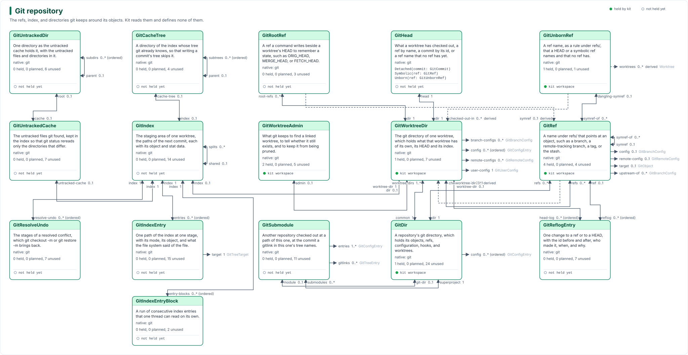

# Git repository

<!-- kit:generate page `kit model page --domain=git-repository` -->
The refs, index, and directories git keeps around its objects. Kit reads them and defines none of them.

## Relations

| Relation | To | Arity | Ordered | Inverse | Means |
| --- | --- | --- | --- | --- | --- |
| GitCacheTree.index | GitIndex | 0..1 |  | GitIndex.cache-tree | The index whose cache tree this node is the root of. |
| GitCacheTree.parent | GitCacheTree | 0..1 |  | GitCacheTree.subtrees | The node of the directory that holds this one, none for the root. |
| GitCacheTree.subtrees | GitCacheTree | 0..* | ordered | GitCacheTree.parent | The nodes of the directory's subdirectories, in the order git writes them. |
| GitDir.config | GitConfigEntry | 0..* | ordered | GitConfigEntry.dir | The entries of the repository's own config file, the local scope every worktree shares, with the files it includes, in the order git reads them. |
| GitDir.module | GitSubmodule | 0..1 |  | GitSubmodule.git-dir | The submodule whose git directory this is, under its superproject's modules/\<name>/ or inside the submodule's checkout. |
| GitDir.refs | GitRef | 0..* |  | GitRef.dir | Every ref of the repository: the shared ones under refs/ here, and each worktree's own, under refs/bisect/, refs/worktree/, and refs/rewritten/ of its git directory. |
| GitDir.submodules | GitSubmodule | 0..* |  | GitSubmodule.superproject | The submodules the repository's .gitmodules and config name. |
| GitDir.worktree-dirs | GitWorktreeDir | 1..* |  | GitWorktreeDir.common | The git directories of the repository's worktrees: this directory itself for the main worktree, or for a bare repository's HEAD, and worktrees/\<id>/ for each linked worktree. |
| GitHead.dir | GitWorktreeDir | 1 |  | GitWorktreeDir.head | The worktree's git directory this HEAD file is in. |
| GitIndex.cache-tree | GitCacheTree | 0..1 |  | GitCacheTree.index | The root of the TREE extension, the cache tree. |
| GitIndex.dir | GitWorktreeDir | 0..1 |  | GitWorktreeDir.index | The worktree's git directory whose index file this is, none for a shared index. |
| GitIndex.entries | GitIndexEntry | 0..* | ordered | GitIndexEntry.index | The entries, sorted bytewise by path, then by stage. |
| GitIndex.entry-blocks | GitIndexEntryBlock | 0..* | ordered | GitIndexEntryBlock.index | The IEOT extension's blocks of entries, in file order, which let threads read the entries in parallel. |
| GitIndex.resolve-undo | GitResolveUndo | 0..* | ordered | GitResolveUndo.index | The REUC extension's records, each a resolved conflict git can recreate with git checkout -m. |
| GitIndex.shared | GitIndex | 0..1 |  | GitIndex.splits | The shared index, sharedindex.\<id> in the same directory, that the link extension names in split index mode, none when its id is all zeros. |
| GitIndex.splits | GitIndex | 0..* |  | GitIndex.shared | The index files whose link extension names this file as their shared index. |
| GitIndex.untracked-cache | GitUntrackedCache | 0..1 |  | GitUntrackedCache.index | The UNTR extension, the untracked cache, which core.untrackedCache writes. |
| GitIndexEntry.index | GitIndex | 1 |  | GitIndex.entries | The index that holds this entry. |
| GitIndexEntry.target | GitTreeTarget | 1 |  | GitTreeTarget.staged-by | The object the entry's id names, as its mode says: a blob, a symlink's blob, a gitlink's commit, which is the submodule's and need not be in this repository, or a sparse directory's tree. |
| GitIndexEntryBlock.index | GitIndex | 1 |  | GitIndex.entry-blocks | The index whose IEOT extension holds this record. |
| GitRef.checked-out-in | GitWorktreeDir | 0..* |  | derived | derived: the worktrees' git directories whose HEAD is Symbolic(this). The worktrees whose HEAD names this ref, a branch as a rule, which git checks out in one worktree at a time. |
| GitRef.config | GitBranchConfig | 0..1 |  | GitBranchConfig.ref | For a branch, its branch.\<branch>.\* settings, none when no setting names it. |
| GitRef.dangling-symref | GitUnbornRef | 0..1 |  | GitUnbornRef.symref-of | The name this symbolic ref holds when no ref has it, which git remote prune warns of as a dangling symref. |
| GitRef.dir | GitDir | 1 |  | GitDir.refs | The repository whose refs hold this ref, a worktree's own refs included. |
| GitRef.reflog | GitReflogEntry | 0..* | ordered | GitReflogEntry.ref | The lines of logs/\<name>, oldest first, which git appends to for a branch, a remote-tracking branch, or a note ref while core.logAllRefUpdates is true, for the stash always, and for any ref whose log file exists. |
| GitRef.remote-config | GitRemoteConfig | 0..1 |  | GitRemoteConfig.tracking-refs | For a remote-tracking branch, the remote it tracks a branch of, none when no remote of that name is configured. |
| GitRef.symref | GitRef | 0..1 |  | GitRef.symref-of | The ref whose name this one holds in place of an id, as refs/remotes/origin/main for refs/remotes/origin/HEAD, which names the remote's default branch, none for a ref that holds an id and for a dangling one, whose name dangling-symref holds in its place, so a symbolic ref has exactly one of the two. |
| GitRef.symref-of | GitRef | 0..* |  | GitRef.symref | The symbolic refs that hold this ref's name. |
| GitRef.target | GitObject | 0..1 |  | GitObject.referenced-by | The object whose id the ref holds, or for a symbolic ref the object its symref chain resolves to, none for a symbolic ref that resolves to no object. |
| GitRef.upstream-of | GitBranchConfig | 0..* |  | GitBranchConfig.upstream-ref | The branches whose upstream this ref is: a remote-tracking branch, or a local branch for a branch whose remote is . (this repository). |
| GitRef.worktree-dir | GitWorktreeDir | 0..1 |  | GitWorktreeDir.refs | For a ref under refs/bisect/, refs/worktree/, or refs/rewritten/, the worktree's git directory that holds it, none for a shared ref. |
| GitReflogEntry.ref | GitRef | 0..1 |  | GitRef.reflog | The ref whose log, logs/\<name>, holds this entry, none for an entry of a HEAD's log. |
| GitReflogEntry.worktree-dir | GitWorktreeDir | 0..1 |  | GitWorktreeDir.head-log | The worktree's git directory whose logs/HEAD holds this entry, none for an entry of a ref's log. |
| GitResolveUndo.index | GitIndex | 1 |  | GitIndex.resolve-undo | The index whose REUC extension holds this record. |
| GitRootRef.dir | GitWorktreeDir | 1 |  | GitWorktreeDir.root-refs | The worktree's git directory this file is in. |
| GitRootRef.symref | GitRef | 0..1 |  | derived | derived: the ref whose name the file holds in place of an id. The ref it names, as NOTES\_MERGE\_REF names the note ref being merged into. |
| GitSubmodule.entries | GitConfigEntry | 1..* |  | GitConfigEntry.submodules | The entries of the submodule.\<name> section in the superproject's .gitmodules and in its configuration. |
| GitSubmodule.git-dir | GitDir | 0..1 |  | GitDir.module | The submodule's own git directory: modules/\<name>/ of the superproject's, or a .git directory inside the submodule's checkout, as a repository cloned there has until git submodule absorbgitdirs moves it, and none while the submodule is not cloned. |
| GitSubmodule.gitlinks | GitTreeEntry | 0..* |  | GitTreeEntry.submodule | The gitlink entries, of mode 160000, at the submodule's path in the superproject's trees. |
| GitSubmodule.superproject | GitDir | 1 |  | GitDir.submodules | The git directory of the repository that holds the submodule. |
| GitUnbornRef.checked-out-in | GitWorktreeDir | 0..* |  | derived | derived: the worktrees' git directories whose HEAD is Unborn(this). The worktrees whose HEAD names this ref name. |
| GitUnbornRef.symref-of | GitRef | 0..* |  | GitRef.dangling-symref | The dangling symbolic refs that hold this name. |
| GitUnbornRef.worktrees | Worktree | 0..* |  | derived | derived: the worktrees whose head is Unborn with this ref name. The worktrees of kit's Code domain that are on this unborn branch, the same worktrees as checked-out-in, seen from kit's side. |
| GitUntrackedCache.index | GitIndex | 1 |  | GitIndex.untracked-cache | The index whose UNTR extension this is. |
| GitUntrackedCache.root | GitUntrackedDir | 0..1 |  | GitUntrackedDir.cache | The block of the worktree's top directory, the first block, none when the cache holds no block. |
| GitUntrackedDir.cache | GitUntrackedCache | 0..1 |  | GitUntrackedCache.root | The untracked cache whose first block this is, none for a subdirectory's block. |
| GitUntrackedDir.parent | GitUntrackedDir | 0..1 |  | GitUntrackedDir.subdirs | The block of the directory that holds this one, none for the top directory. |
| GitUntrackedDir.subdirs | GitUntrackedDir | 0..* | ordered | GitUntrackedDir.parent | The blocks of its subdirectories, in the order git writes them. |
| GitWorktreeAdmin.worktree-dir | GitWorktreeDir | 1 |  | GitWorktreeDir.admin | The linked worktree's git directory, worktrees/\<id>/, of which these are files. |
| GitWorktreeDir.admin | GitWorktreeAdmin | 0..1 |  | GitWorktreeAdmin.worktree-dir | For a linked worktree, the files only a linked worktree has, none for the main worktree. |
| GitWorktreeDir.branch-configs | GitBranchConfig | 0..* |  | GitBranchConfig.worktree-dir | The branch.\<name> settings git config gives when run in this worktree, one a branch. |
| GitWorktreeDir.common | GitDir | 1 |  | GitDir.worktree-dirs | The common git directory of the repository this worktree belongs to, which is this directory for the main one. |
| GitWorktreeDir.config | GitConfigEntry | 0..* | ordered | GitConfigEntry.worktree-dir | The entries of config.worktree, the worktree scope, which git reads after the local config while extensions.worktreeConfig is true. |
| GitWorktreeDir.head | GitHead | 1 |  | GitHead.dir | The HEAD file, what the worktree has checked out. |
| GitWorktreeDir.head-log | GitReflogEntry | 0..* | ordered | GitReflogEntry.worktree-dir | The lines of logs/HEAD, oldest first, each a change to the worktree's HEAD. |
| GitWorktreeDir.index | GitIndex | 0..1 |  | GitIndex.dir | The index file, none in a bare repository and while the worktree has no index file, as with git worktree add --no-checkout. |
| GitWorktreeDir.refs | GitRef | 0..* |  | GitRef.worktree-dir | The worktree's own refs, under refs/bisect/, refs/worktree/, and refs/rewritten/ of this directory. |
| GitWorktreeDir.remote-configs | GitRemoteConfig | 0..* |  | GitRemoteConfig.worktree-dir | The remotes git config defines when run in this worktree. |
| GitWorktreeDir.root-refs | GitRootRef | 0..* |  | GitRootRef.dir | The refs beside HEAD, such as ORIG\_HEAD, MERGE\_HEAD, and FETCH\_HEAD. |
| GitWorktreeDir.user-config | GitUserConfig | 1 |  | GitUserConfig.worktree-dir | Who git writes as the author and committer when run in this worktree, and how it signs. |

## Entities

### GitCacheTree

A directory of the index whose tree git already knows, so that writing a commit's tree skips it.

Layer: native (git)

| Field | Type | Arity | Source | Status | Read by | Means |
| --- | --- | --- | --- | --- | --- | --- |
| entry-count | Int | 1 | stored | unused |  | The number of index entries under the directory, or -1 once a change under it has made the node invalid. |
| id | Hash | 0..1 | stored | unused |  | The id of the tree that writing these entries gives, none for an invalid node. |
| path | Bytes | 1 | stored | unused |  | The directory's name within its parent's, empty for the root. |
| subtree-count | Int | 1 | stored | unused |  | The number of direct subtrees, the nodes of the directory's own subdirectories, which follow this node. |

### GitDir

A repository's git directory, which holds its objects, refs, configuration, hooks, and worktrees.

Layer: native (git)

| Field | Type | Arity | Source | Status | Read by | Means |
| --- | --- | --- | --- | --- | --- | --- |
| alternates | Path | 0..* | stored | unused |  | The lines of objects/info/alternates, the object stores this one borrows objects from. |
| attributes | Text | 0..* | stored | unused |  | The lines of info/attributes, attributes of this repository alone, as gitattributes reads them. |
| bare | Bool | 1 | stored | unused |  | The value of core.bare, whether the repository has no main worktree. |
| checkout | Path | 0..1 | derived | held | `workspace repos checkout` | derived from the directory that holds this directory as its .git directory, as git:desks in modules/bash/git.sh finds a desk; none where no directory does. Where the main worktree is, the desk kit names. It is none for a bare repository, for a repository whose .git is a file, as with --separate-git-dir, and for a submodule's git directory under its superproject's modules/\<name>/. That submodule's checkout holds a .git file, which core.worktree names back, and git:desks never reaches it, because its walk stops at the superproject's desk. |
| description | Text | 0..1 | stored | unused |  | The description file, which gitweb shows and git init fills with a placeholder. |
| exclude | Text | 0..* | stored | unused |  | The lines of info/exclude, ignore patterns of this repository alone, as gitignore reads them. |
| file-mode | Bool | 1 | stored | unused |  | The value of core.fileMode, whether git trusts the executable bit of the files in the worktree, which git init writes after it tests the file system. |
| format-version | enum(0, 1) | 1 | stored | unused |  | The value of core.repositoryformatversion, 1 when the config's extensions section is in force. |
| grafts | Text | 0..* | stored | unused |  | The lines of info/grafts, each a commit's id and the ids git takes as its parents, which git replace supersedes. |
| hooks | Path | 0..* | stored | unused |  | The hook programs under hooks/, or under the directory core.hooksPath names, a sample one ending in .sample. |
| http-alternates | Url | 0..* | stored | unused |  | The lines of objects/info/http-alternates, the object stores a fetch over HTTP borrows from. |
| ignore-case | Bool | 1 | stored | unused |  | The value of core.ignoreCase, whether git takes two paths that differ only in case as one, which git init writes true on a file system that ignores case. |
| info-refs | Text | 0..* | stored | unused |  | The lines of info/refs, each a ref's id and name, which git update-server-info writes for dumb transports. |
| legacy-remotes | Path | 0..* | stored | unused |  | The files under remotes/ and branches/, another way to name a remote, which git reads beside the remote.\<name> sections of the configuration. |
| log-all-ref-updates | enum(true, false, always) | 1 | stored | unused |  | The value of core.logAllRefUpdates, which refs keep a reflog: true for branches, remote-tracking branches, notes, and HEAD, always for every ref, false for none; git init writes true in a repository with a worktree. |
| object-format | enum(sha1, sha256) | 1 | stored | unused |  | The value of extensions.objectFormat, the hash that names objects, sha1 when unset. |
| objects | Path | 1 | stored | unused |  | The object database, objects/ under this directory: the loose objects in a directory per first two digits of their ids, the packs under pack/, and info/. |
| packed-refs-traits | Text | 0..* | stored | unused |  | The traits the header of packed-refs names, as peeled, fully-peeled, and sorted. |
| packs | Text | 0..* | stored | unused |  | The lines of objects/info/packs, which git update-server-info writes for dumb transports. |
| path | Path | 1 | derived | unused |  | derived from git rev-parse --path-format=absolute --git-common-dir. Where the directory is. |
| precompose-unicode | Bool | 1 | stored | unused |  | The value of core.precomposeUnicode, whether git on macOS turns the decomposed Unicode of a file name into the precomposed form, which git init writes on macOS. |
| ref-format | enum(files, reftable) | 1 | stored | unused |  | The value of extensions.refStorage, files for loose refs under refs/ and the packed-refs file, or reftable for the tables under reftable/, files when unset. |
| shallow | Hash | 0..* | stored | unused |  | The ids in the shallow file, the commits of a shallow clone whose parents are not here. |
| worktree | Path | 0..1 | stored | unused |  | The value of core.worktree, the top of the main worktree where it is not the directory that holds this one, as git submodule writes it in modules/\<name>/config, none when unset. |
| worktree-config | Bool | 1 | stored | unused |  | The value of extensions.worktreeConfig, whether git reads each worktree's config.worktree after the local config, false when unset. |

### GitHead

What a worktree has checked out, a ref by name, a commit by its id, or a ref name that no ref has yet.

Layer: native (git)

| Variant | Field | Type |
| --- | --- | --- |
| Detached | commit | GitCommit |
| Symbolic | ref | GitRef |
| Unborn | ref | GitUnbornRef |

### GitIndex

The staging area of one worktree, the paths of the next commit, each with its object and stat data.

Layer: native (git)

| Field | Type | Arity | Source | Status | Read by | Means |
| --- | --- | --- | --- | --- | --- | --- |
| checksum | Hash | 1 | stored | unused |  | The hash of the file's content before it, all zeros when index.skipHash is true. |
| count | Int | 1 | stored | unused |  | The number of entries. |
| entries-end | Int | 0..1 | stored | unused |  | The EOIE extension's offset of the end of the entries, which git writes last so a reader finds it first. |
| entry-offsets-version | enum(1) | 0..1 | stored | unused |  | The version of the IEOT extension, the index entry offset table, which index.threads writes. |
| extensions-hash | Hash | 0..1 | stored | unused |  | The EOIE extension's hash over the signature and size of each extension before it. |
| fsmonitor-dirty | Bytes | 0..1 | stored | unused |  | The FSMN extension's EWAH bitmap, whose n-th bit is set when the n-th entry may have changed. |
| fsmonitor-token | Text | 0..1 | stored | unused |  | The point the FSMN extension reflects every change through: in version 1 a time in nanoseconds since the epoch, in version 2 an opaque token of the monitor's. |
| fsmonitor-version | enum(1, 2) | 0..1 | stored | unused |  | The version of the FSMN extension, the file system monitor cache, when core.fsmonitor writes one. |
| other-extensions | Bytes | 0..* | stored | unused |  | Each optional extension git does not know, as its signature, its size, and its data, in file order. |
| signature | enum(DIRC) | 1 | stored | unused |  | The four bytes that open the file, DIRC for dircache. |
| sparse | Bool | 1 | stored | unused |  | Whether the index holds the sdir extension, which marks a sparse index whose entries include directories outside a cone-mode sparse checkout. |
| split-delete | Bytes | 0..1 | stored | unused |  | The link extension's EWAH bitmap of the shared index's entries this index removes. |
| split-replace | Bytes | 0..1 | stored | unused |  | The link extension's EWAH bitmap of the shared index's entries this index's own entries replace, in order. |
| version | enum(2, 3, 4) | 1 | stored | unused |  | The format of the entries: 2, 3 when an entry has extended flags, or 4, whose paths are prefix-compressed, as index.version or git update-index --index-version sets. |

### GitIndexEntry

One path of the index at one stage, with its mode, its object, and what the file system said of the file.

Layer: native (git)

| Field | Type | Arity | Source | Status | Read by | Means |
| --- | --- | --- | --- | --- | --- | --- |
| assume-valid | Bool | 1 | stored | unused |  | Whether git takes the file as unchanged without checking it, as git update-index --assume-unchanged sets. |
| ctime | Time | 1 | stored | unused |  | The last time the file's metadata changed, in seconds and nanoseconds, from stat(2). |
| dev | Int | 1 | stored | unused |  | The device of the file, from stat(2), as 32 bits. |
| extended | Bool | 1 | stored | unused |  | Whether a second flags field follows, which only version 3 and later allow. |
| gid | Int | 1 | stored | unused |  | The group of the file, from stat(2). |
| ino | Int | 1 | stored | unused |  | The inode of the file, from stat(2), as 32 bits. |
| intent-to-add | Bool | 1 | stored | unused |  | Whether git add -N added the path with no content yet, from the extended flags, its object the empty blob. |
| mode | enum(100644, 100755, 120000, 160000, 40000) | 1 | stored | unused |  | The entry's kind, which kit reads only to give a path's type and whether it is executable: 100644 a file, 100755 an executable, 120000 a symlink, 160000 a gitlink, and 40000 a sparse directory, which git ls-files --stage prints padded as 040000. |
| mtime | Time | 1 | stored | unused |  | The last time the file's data changed, in seconds and nanoseconds, from stat(2). |
| name-length | Int | 1 | stored | unused |  | The length of the path in bytes, from the flags field, or 4095 for a path that long or longer. |
| path | Bytes | 1 | stored | unused |  | The path from the top of the worktree, with / between its parts, no NUL, and a / at the end only for a sparse directory, which kit facts --moment=commit gives as a key of its tree. |
| size | Int | 1 | stored | unused |  | The file's size on disk, from stat(2), truncated to 32 bits. |
| skip-worktree | Bool | 1 | stored | unused |  | Whether a sparse checkout leaves the path out of the worktree, from the extended flags. |
| stage | enum(0, 1, 2, 3) | 1 | stored | unused |  | The merge stage, which kit reads only to keep stage 0: 0 for a path with no conflict, and 1, 2, and 3 for the common ancestor's, ours, and theirs in a conflict. |
| uid | Int | 1 | stored | unused |  | The owner of the file, from stat(2). |

### GitIndexEntryBlock

A run of consecutive index entries that one thread can read on its own.

Layer: native (git)

| Field | Type | Arity | Source | Status | Read by | Means |
| --- | --- | --- | --- | --- | --- | --- |
| count | Int | 1 | stored | unused |  | The number of entries in the block. |
| offset | Int | 1 | stored | unused |  | The offset from the start of the index file to the block's first entry, in bytes. |

### GitRef

A name under refs/ that points at an object, such as a branch, a remote-tracking branch, a tag, or the stash.

Layer: native (git)

| Field | Type | Arity | Source | Status | Read by | Means |
| --- | --- | --- | --- | --- | --- | --- |
| branch | Text | 0..1 | derived | held | `workspace branches branch` | derived from the name after refs/heads/, or after refs/remotes/\<remote>/. For a branch its name, and for a remote-tracking branch the name of the branch on the remote. |
| kind | enum(branch, remote-tracking, tag, note, stash, other) | 1 | derived | unused |  | derived from the name's start: refs/heads/ for a branch, refs/remotes/ for a remote-tracking branch, refs/tags/ for a tag, refs/notes/ for a note ref, the name refs/stash for the stash, and any other for other. Which kind of ref this is, which git reads only from where its name lies under refs/. |
| name | Text | 1 | stored | unused |  | The full name, as refs/heads/main or refs/remotes/origin/main. |
| peeled | Hash | 0..1 | stored | unused |  | The id of the object an annotated tag the ref names points at, from the ^ line under the ref in packed-refs, which git writes when the file's header says peeled or fully-peeled. |
| per-worktree | Bool | 1 | derived | unused |  | derived from whether the name starts refs/bisect/, refs/worktree/, or refs/rewritten/. Whether each worktree has a ref of this name of its own. |
| remote | Text | 0..1 | derived | held | `workspace branches remote` | derived from the longest configured remote name that starts the name after refs/remotes/, followed by a slash. For a remote-tracking branch, the name of the remote it tracks a branch of, which may hold a slash. |
| short-name | Text | 1 | derived | held | `workspace tags tag` | derived from the name after refs/heads/, refs/tags/, or refs/remotes/, else after refs/, as git for-each-ref %(refname:short) prints it, which keeps a part such as tags/ where a ref of another kind has the same short name. The name git shows the ref by, as main, origin/main, or v1.0. |
| tag-kind | enum(annotated, lightweight) | 0..1 | derived | held | `workspace tags kind` | derived from the type of the target, annotated for a tag object and lightweight for any other. For a tag, whether it names a tag object or names an object directly. |

### GitReflogEntry

One change to a ref or to a HEAD, with the id before and after, who made it, when, and why.

Layer: native (git)

| Field | Type | Arity | Source | Status | Read by | Means |
| --- | --- | --- | --- | --- | --- | --- |
| email | Text | 1 | stored | unused |  | The committer's email, between the angle brackets. |
| message | Text | 0..1 | stored | unused |  | What the command that moved the ref says of the change, such as "commit: \<subject>", as git reflog %gs prints it. |
| name | Text | 1 | stored | unused |  | The committer's name, as git commit would write it at the time of the change. |
| new | Hash | 1 | stored | unused |  | The id the ref holds after the change, all zeros when the change deleted it. |
| offset | Text | 1 | stored | unused |  | The time zone the moment was written in, as a sign and four digits, such as -0800. |
| old | Hash | 1 | stored | unused |  | The id the ref held before the change, all zeros when the change created the ref. |
| time | Time | 1 | stored | unused |  | The moment of the change, in seconds since the epoch. |

### GitResolveUndo

The stages of a resolved conflict, which git checkout -m or git restore -m brings back.

Layer: native (git)

| Field | Type | Arity | Source | Status | Read by | Means |
| --- | --- | --- | --- | --- | --- | --- |
| base | Hash | 0..1 | stored | unused |  | The id of stage 1's object. |
| base-mode | enum(0, 100644, 100755, 120000, 160000) | 1 | stored | unused |  | The mode of stage 1, the common ancestor's, or 0 when it has none. |
| ours | Hash | 0..1 | stored | unused |  | The id of stage 2's object. |
| ours-mode | enum(0, 100644, 100755, 120000, 160000) | 1 | stored | unused |  | The mode of stage 2, ours, or 0 when it has none. |
| path | Bytes | 1 | stored | unused |  | The conflicted path, from the top of the worktree. |
| theirs | Hash | 0..1 | stored | unused |  | The id of stage 3's object. |
| theirs-mode | enum(0, 100644, 100755, 120000, 160000) | 1 | stored | unused |  | The mode of stage 3, theirs, or 0 when it has none. |

### GitRootRef

A ref a command writes beside a worktree's HEAD to remember a state, such as ORIG\_HEAD, MERGE\_HEAD, or FETCH\_HEAD.

Layer: native (git)

| Field | Type | Arity | Source | Status | Read by | Means |
| --- | --- | --- | --- | --- | --- | --- |
| fetched | Text | 0..* | stored | unused |  | For FETCH\_HEAD, the rest of each line after its id, not-for-merge or empty, a tab, and the ref and the repository it was fetched from. |
| ids | Hash | 0..* | stored | unused |  | The ids it holds, in the file's order: one for most, each commit being merged for MERGE\_HEAD, and each fetched ref's for FETCH\_HEAD. |
| name | Text | 1 | stored | unused |  | The file's name: ORIG\_HEAD, FETCH\_HEAD, MERGE\_HEAD, CHERRY\_PICK\_HEAD, REVERT\_HEAD, REBASE\_HEAD, BISECT\_HEAD, AUTO\_MERGE, BISECT\_EXPECTED\_REV, MERGE\_AUTOSTASH, NOTES\_MERGE\_PARTIAL, NOTES\_MERGE\_REF, or a tool's own. |

### GitSubmodule

Another repository checked out at a path of this one, at the commit a gitlink in this one's tree names.

Layer: native (git)

| Field | Type | Arity | Source | Status | Read by | Means |
| --- | --- | --- | --- | --- | --- | --- |
| active | Bool | 0..1 | stored | unused |  | The value of submodule.\<name>.active in the config, which wins over submodule.active's pathspecs. |
| branch | Text | 0..1 | stored | unused |  | The branch of the submodule git submodule update --remote follows, . for the superproject's own branch's name. |
| configured-url | Text | 0..1 | stored | unused |  | The value of submodule.\<name>.url in the config, which git submodule init resolves and copies from .gitmodules. |
| fetch-recurse-submodules | enum(true, false, on-demand) | 0..1 | stored | unused |  | Whether a fetch of the superproject fetches the submodule always, never, or when the gitlink changes. |
| gitdir | Path | 0..1 | stored | unused |  | The value of submodule.\<name>.gitdir, its git directory, which git reads only with extensions.submodulePathConfig. |
| ignore | enum(all, dirty, untracked, none) | 0..1 | stored | unused |  | What changes in the submodule git status and git diff leave out, none when unset. |
| name | Text | 1 | stored | unused |  | The subsection of submodule.\<name>, the submodule's path unless git submodule add --name gave another. |
| path | Path | 1 | stored | unused |  | The value of submodule.\<name>.path, where the submodule is checked out, with no / at its end. |
| shallow | Bool | 0..1 | stored | unused |  | Whether a clone of the submodule is shallow, a history of depth 1. |
| update | Text | 0..1 | stored | unused |  | How git submodule update updates it: checkout, rebase, merge, or none, and in the config also ! and a command. |
| url | Text | 1 | stored | unused |  | The value of submodule.\<name>.url in .gitmodules, a URL or a path starting ./ or ../ from the superproject's origin. |

### GitUnbornRef

A ref name, as a rule under refs/, that a HEAD or a symbolic ref names and that no ref has.

Layer: native (git)

| Field | Type | Arity | Source | Status | Read by | Means |
| --- | --- | --- | --- | --- | --- | --- |
| name | Text | 1 | stored | unused |  | The full name the HEAD or the symbolic ref holds, as refs/heads/main. |
| short-name | Text | 1 | derived | held | `workspace worktrees branch` | derived from the name after refs/heads/, as git worktree list --porcelain gives it on its branch line, else after refs/. The branch's name, which kit prints as a worktree's branch, for an unborn branch as for a branch that exists, whose name GitRef holds. |

### GitUntrackedCache

The untracked files git found, kept in the index so that git status rereads only the directories that differ.

Layer: native (git)

| Field | Type | Arity | Source | Status | Read by | Means |
| --- | --- | --- | --- | --- | --- | --- |
| dir-flags | Int | 1 | stored | unused |  | The flags of git's directory walk the cache was made with, as 32 bits. |
| environment | Text | 0..* | stored | unused |  | The strings that say where the cache holds, such as the worktree's location and the system, in order. |
| exclude-per-dir | Text | 1 | stored | unused |  | The name of the exclude file each directory may hold, usually .gitignore. |
| excludes-file-id | Hash | 0..1 | stored | unused |  | The id of core.excludesFile's content, none when the file does not exist. |
| excludes-file-stat | Bytes | 1 | stored | unused |  | The stat data of the file core.excludesFile names, as an index entry's, from ctime to size. |
| info-exclude-id | Hash | 0..1 | stored | unused |  | The id of info/exclude's content, none when the file does not exist. |
| info-exclude-stat | Bytes | 1 | stored | unused |  | The stat data of the common git directory's info/exclude, as an index entry's, from ctime to size. |

### GitUntrackedDir

One directory as the untracked cache holds it, with the untracked files and directories in it.

Layer: native (git)

| Field | Type | Arity | Source | Status | Read by | Means |
| --- | --- | --- | --- | --- | --- | --- |
| check-only | Bool | 1 | stored | unused |  | Whether git only checked that the directory holds an untracked file, from the second bitmap. |
| exclude-id | Hash | 0..1 | stored | unused |  | The id of the directory's exclude file, such as .gitignore, when the third bitmap marks it valid. |
| name | Bytes | 1 | stored | unused |  | The directory's name within its parent's, empty for the top directory. |
| stat | Bytes | 0..1 | stored | unused |  | The directory's stat data, as an index entry's, when the third bitmap marks its stat data and id valid. |
| untracked | Bytes | 0..* | stored | unused |  | The names of the untracked files and directories in it, in the order git writes them. |
| valid | Bool | 1 | stored | unused |  | Whether the block's untracked names are valid, from the first bitmap. |

### GitWorktreeAdmin

What git keeps to find a linked worktree, to tell whether it still exists, and to keep it from being pruned.

Layer: native (git)

| Field | Type | Arity | Source | Status | Read by | Means |
| --- | --- | --- | --- | --- | --- | --- |
| commondir | Path | 1 | stored | unused |  | The content of commondir, the common git directory's path relative to this directory, usually ../.., which kit reads only to confirm a worktree's trust name. |
| gitdir | Path | 0..1 | stored | unused |  | The content of gitdir, the path of the worktree's .git file, absolute or, with worktree.useRelativePaths, relative, which kit reads only to confirm a worktree's trust name, none when the file does not exist, which git worktree prune gives as its reason. |
| id | Text | 1 | stored | unused |  | The directory's name under worktrees/, the worktree's folder name with a number added where it is taken. |
| lock-reason | Text | 0..1 | stored | unused |  | The content of locked, why the worktree is locked, none when the file is empty or absent. |
| locked | Bool | 1 | derived | held | `workspace worktrees locked` | derived from whether the file locked exists. Whether git worktree lock has kept the worktree from being pruned, moved, or removed, which kit prints as "locked" or null. |
| prunable | Bool | 1 | derived | held | `workspace worktrees prunable` | derived from whether the worktree is unlocked and gitdir names no file, as git worktree list --porcelain prints prunable. Whether git worktree prune would remove the directory, which kit prints as "prunable" or null. |
| prune-reason | Text | 0..1 | derived | unused |  | derived from what git worktree list --porcelain prints after prunable. Why the directory can be pruned, as "gitdir file points to non-existent location". |

### GitWorktreeDir

The git directory of one worktree, which holds what that worktree has of its own, its HEAD and its index.

Layer: native (git)

| Field | Type | Arity | Source | Status | Read by | Means |
| --- | --- | --- | --- | --- | --- | --- |
| commit-message-draft | Text | 0..1 | stored | unused |  | The content of COMMIT\_EDITMSG, the message git commit gives the editor, which stays after the commit, none before the worktree's first commit. |
| dotgit | Text | 0..1 | stored | unused |  | The content of the .git file at the top of the working tree, gitdir: and this directory's path, which kit reads only to find a worktree's trust name, none where .git is this directory itself or there is no working tree. |
| main | Bool | 1 | derived | unused |  | derived from whether the directory is the common directory. Whether this is the main worktree's git directory, which a bare repository's is too. |
| merge-message | Text | 0..1 | stored | unused |  | The content of MERGE\_MSG, the message git merge proposes while a merge is under way, none otherwise. |
| merge-mode | Text | 0..1 | stored | unused |  | The content of MERGE\_MODE, the options git merge records for the commit that ends a merge, such as no-ff, none while no merge is under way. |
| path | Path | 1 | derived | unused |  | derived from git rev-parse --absolute-git-dir, run in the worktree. Where the directory is, the common directory for the main worktree and worktrees/\<id>/ for a linked one. |
| sparse-checkout | Text | 0..* | stored | unused |  | The lines of info/sparse-checkout, the patterns of this worktree's sparse checkout, in order. |
| worktree-path | Path | 0..1 | derived | held | `workspace worktrees path` | derived from the worktree line of git worktree list --porcelain: the directory that holds the .git file gitdir names for a linked worktree, the directory that holds the .git directory for the main worktree, and the git directory itself for a bare repository or a main worktree whose .git is a file, as --separate-git-dir makes. Where git says the worktree is, the top of its working tree or, for a bare repository and a main worktree whose .git is a file, the git directory itself, and none only for a worktrees/\<id>/ that git worktree list does not list, as when its gitdir file does not exist. |
<!-- kit:end page -->
