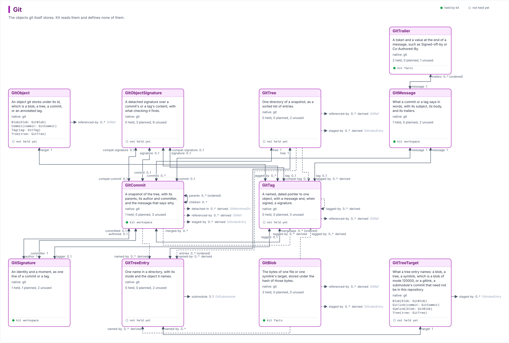

# Git

<!-- kit:generate page `kit model page --domain=git` -->
The objects git itself stores. Kit reads them and defines none of them.

## Relations

| Relation | To | Arity | Ordered | Inverse | Means |
| --- | --- | --- | --- | --- | --- |
| GitBlob.named-by | GitTreeEntry | 0..* |  | derived | derived: the tree entries whose target is Blob(this) or Symlink(this). The tree entries that name this blob, as a file or as a symlink. |
| GitBlob.referenced-by | GitRef | 0..* |  | derived | derived: the refs whose target is Blob(this). The refs that name this blob, such as a lightweight tag. |
| GitBlob.staged-by | GitIndexEntry | 0..* |  | derived | derived: the index entries whose target is Blob(this) or Symlink(this). The index entries that stage this blob, as a file or as a symlink. |
| GitBlob.tagged-by | GitTag | 0..* |  | derived | derived: the annotated tags whose target is Blob(this). The annotated tags whose object header names this blob. |
| GitCommit.author | GitSignature | 1 |  | GitSignature.authored | The author header, which says who wrote the change and when. |
| GitCommit.children | GitCommit | 0..* |  | GitCommit.parents | The commits that name this commit as a parent, which git finds by walking from refs and never stores here. |
| GitCommit.committer | GitSignature | 1 |  | GitSignature.committed | The committer header, which says who made this commit object and when. |
| GitCommit.compat-signature | GitObjectSignature | 0..1 |  | GitObjectSignature.compat-commit | The signature over the commit in the other object format, in the other of the two headers, which a repository with extensions.compatObjectFormat writes. |
| GitCommit.detached-in | GitWorktreeDir | 0..* |  | derived | derived: the git directories of this repository's worktrees whose HEAD is Detached(this). The worktrees of the repository that holds this commit that have it checked out on a detached HEAD, and not another repository's worktrees on a commit of the same id. |
| GitCommit.mergetags | GitTag | 0..* | ordered | GitTag.merged-by | The mergetag headers, each the whole of a signed tag that this merge merged, embedded with its signature, whose tag object need not be in this repository. |
| GitCommit.message | GitMessage | 1 |  | GitMessage.commit | Everything after the blank line that ends the headers. |
| GitCommit.named-by | GitTreeEntry | 0..* |  | derived | derived: the tree entries whose target is Gitlink(this), which a superproject holds, usually in another repository. The gitlink entries that name this commit as a submodule's. |
| GitCommit.parents | GitCommit | 0..* | ordered | GitCommit.children | The parent headers, none for a root commit and two or more for a merge, the first the one merged into. |
| GitCommit.referenced-by | GitRef | 0..* |  | derived | derived: the refs whose target is Commit(this). The refs that name this commit, such as the branches whose tip it is. |
| GitCommit.signature | GitObjectSignature | 0..1 |  | GitObjectSignature.commit | The signature over the commit in the repository's object format, in the gpgsig header of a SHA-1 repository and the gpgsig-sha256 header of a SHA-256 one. |
| GitCommit.staged-by | GitIndexEntry | 0..* |  | derived | derived: the index entries whose target is Gitlink(this), which a superproject's index holds. The gitlink entries that stage this commit as a submodule's. |
| GitCommit.tagged-by | GitTag | 0..* |  | derived | derived: the annotated tags whose target is Commit(this). The annotated tags whose object header names this commit. |
| GitCommit.tree | GitTree | 1 |  | GitTree.commits | The tree header, which names the snapshot's root directory. |
| GitMessage.commit | GitCommit | 0..1 |  | GitCommit.message | The commit this message belongs to. |
| GitMessage.tag | GitTag | 0..1 |  | GitTag.message | The annotated tag this message belongs to. |
| GitMessage.trailers | GitTrailer | 0..* | ordered | GitTrailer.message | The trailers of the message's last paragraph, in the order they appear, when that paragraph is all trailers, or holds at least one trailer git adds or a trailer.\<key> setting names and is at least 25% trailers. |
| GitObject.referenced-by | GitRef | 0..* |  | GitRef.target | The refs whose target is this object. |
| GitObject.tagged-by | GitTag | 0..* |  | GitTag.target | The annotated tags whose object header names this object. |
| GitObjectSignature.commit | GitCommit | 0..1 |  | GitCommit.signature | The commit this signature signs in the repository's object format. |
| GitObjectSignature.compat-commit | GitCommit | 0..1 |  | GitCommit.compat-signature | The commit this signature signs in the other object format. |
| GitObjectSignature.compat-tag | GitTag | 0..1 |  | GitTag.compat-signature | The tag this signature signs in the other object format. |
| GitObjectSignature.tag | GitTag | 0..1 |  | GitTag.signature | The tag whose body ends with this signature. |
| GitSignature.authored | GitCommit | 0..1 |  | GitCommit.author | The commit whose author line this is. |
| GitSignature.committed | GitCommit | 0..1 |  | GitCommit.committer | The commit whose committer line this is. |
| GitSignature.tagged | GitTag | 0..1 |  | GitTag.tagger | The tag whose tagger line this is. |
| GitTag.compat-signature | GitObjectSignature | 0..1 |  | GitObjectSignature.compat-tag | The signature over the tag in the other object format, in a gpgsig-sha256 header in a SHA-1 repository and a gpgsig header in a SHA-256 one. |
| GitTag.merged-by | GitCommit | 0..* |  | GitCommit.mergetags | The merge commits that embed this tag in a mergetag header. |
| GitTag.message | GitMessage | 1 |  | GitMessage.tag | Everything after the blank line that ends the headers, up to the signature. |
| GitTag.referenced-by | GitRef | 0..* |  | derived | derived: the refs whose target is Tag(this). The refs that name this tag object, usually the one under refs/tags/ that made it. |
| GitTag.signature | GitObjectSignature | 0..1 |  | GitObjectSignature.tag | The signature at the end of the tag's body, over the tag in the repository's object format. |
| GitTag.tagged-by | GitTag | 0..* |  | derived | derived: the annotated tags whose target is Tag(this). The annotated tags whose object header names this tag. |
| GitTag.tagger | GitSignature | 0..1 |  | GitSignature.tagged | The tagger header, who made the tag and when, which only tags made by the earliest versions of git lack. |
| GitTag.target | GitObject | 1 |  | GitObject.tagged-by | The object header, the object this tag points at. |
| GitTrailer.message | GitMessage | 1 |  | GitMessage.trailers | The message whose last paragraph holds this trailer. |
| GitTree.commits | GitCommit | 0..* |  | GitCommit.tree | The commits whose snapshot is this tree. |
| GitTree.entries | GitTreeEntry | 0..* | ordered | GitTreeEntry.tree | The entries of this directory, sorted bytewise by name, a subtree's name sorting as if followed by a slash. |
| GitTree.named-by | GitTreeEntry | 0..* |  | derived | derived: the tree entries whose target is Tree(this). The entries of other trees that name this tree as a subdirectory. |
| GitTree.referenced-by | GitRef | 0..* |  | derived | derived: the refs whose target is Tree(this). The refs that name this tree. |
| GitTree.staged-by | GitIndexEntry | 0..* |  | derived | derived: the index entries whose target is Tree(this), the sparse directories of a sparse index. The sparse directory entries that stage this tree. |
| GitTree.tagged-by | GitTag | 0..* |  | derived | derived: the annotated tags whose target is Tree(this). The annotated tags whose object header names this tree. |
| GitTreeEntry.submodule | GitSubmodule | 0..1 |  | GitSubmodule.gitlinks | The submodule whose gitlink this entry is, for an entry of mode 160000 whose path .gitmodules names. |
| GitTreeEntry.target | GitTreeTarget | 1 |  | GitTreeTarget.named-by | The object the entry names, a blob, a tree, a symlink, or a gitlink, as its mode says. |
| GitTreeEntry.tree | GitTree | 1 |  | GitTree.entries | The tree that holds this entry. |
| GitTreeTarget.named-by | GitTreeEntry | 0..* |  | GitTreeEntry.target | The tree entries that name this object. |
| GitTreeTarget.staged-by | GitIndexEntry | 0..* |  | GitIndexEntry.target | The index entries that stage this object. |

## Entities

### GitBlob

The bytes of one file or one symlink's target, stored under the hash of those bytes.

Layer: native (git)

| Field | Type | Arity | Source | Status | Read by | Means |
| --- | --- | --- | --- | --- | --- | --- |
| content | Bytes | 1 | stored | held | `facts tree.*.text` | The bytes git stores, which kit facts gives as text, decoded as UTF-8 by jq, for a file of at most 65536 bytes with no NUL whose path kit.yml names under facts.read. |
| id | Hash | 1 | derived | held | `facts tree.*.blob` | derived from the hash of "blob \<size>", a NUL byte, and the content, in the repository's object format, SHA-1 or SHA-256. The object's name, which kit facts gives for each path of the tree, except that for a gitlink path the same key holds the submodule's commit id. |
| size | Int | 1 | derived | held | `facts tree.*.size` | derived from the length of the content in bytes, as git cat-file -s prints it. The content's length in bytes, which kit facts gives for each path of the tree and as 0 for a gitlink path. |

### GitCommit

A snapshot of the tree, with its parents, its author and committer, and the message that says why.

Layer: native (git)

| Field | Type | Arity | Source | Status | Read by | Means |
| --- | --- | --- | --- | --- | --- | --- |
| encoding | Text | 0..1 | stored | unused |  | The encoding header, the message's character encoding when it is not UTF-8, from i18n.commitEncoding. |
| extra-headers | Text | 0..* ordered | stored | unused |  | Each header git does not know, as its name, a space, and its value, which git keeps verbatim and in order. |
| id | Hash | 1 | derived | held | `workspace commits key` | derived from the hash of "commit \<size>", a NUL byte, and the content, in the repository's object format, SHA-1 or SHA-256. The object's name. |
| size | Int | 1 | derived | unused |  | derived from the length of the headers and the message in bytes, as git cat-file -s prints it. The length of the commit object's content in bytes. |

### GitMessage

What a commit or a tag says in words, with its subject, its body, and its trailers.

Layer: native (git)

| Field | Type | Arity | Source | Status | Read by | Means |
| --- | --- | --- | --- | --- | --- | --- |
| body | Text | 1 | derived | unused |  | derived from the text after the first paragraph, as git log %b prints it. The rest of the message, trailers included. |
| subject | Text | 1 | derived | held | `workspace commits subject` | derived from the first paragraph of the text, its lines joined by spaces, as git log %s prints it. The title of the message. |
| text | Bytes | 1 | stored | unused |  | The message as stored, UTF-8 unless a commit's encoding header names another, which kit reads only to parse trailers. |

### GitObject

An object git stores under its id, which is a blob, a tree, a commit, or an annotated tag.

Layer: native (git)

| Variant | Field | Type |
| --- | --- | --- |
| Blob | blob | GitBlob |
| Commit | commit | GitCommit |
| Tag | tag | GitTag |
| Tree | tree | GitTree |

### GitObjectSignature

A detached signature over a commit's or a tag's content, with what checking it finds.

Layer: native (git)

| Field | Type | Arity | Source | Status | Read by | Means |
| --- | --- | --- | --- | --- | --- | --- |
| armor | Text | 1 | stored | unused |  | The signature as stored, from its BEGIN line to its END line. |
| fingerprint | Text | 0..1 | derived | unused |  | derived from checking the armor, as git log %GF prints it. The fingerprint of the key that made the signature. |
| format | enum(openpgp, x509, ssh) | 1 | derived | unused |  | derived from the armor's BEGIN line, PGP SIGNATURE or PGP MESSAGE, SIGNED MESSAGE, or SSH SIGNATURE. The kind of signature, as gpg.format names it. |
| header | enum(gpgsig, gpgsig-sha256) | 0..1 | stored | unused |  | The header that holds the signature, which agrees with the object format and the relation that holds it: gpgsig for a commit's signature in a SHA-1 repository, gpgsig-sha256 in a SHA-256 one, the other header for a compat-signature, and none for the signature at the end of a tag's body. |
| key | Text | 0..1 | derived | planned |  | derived from checking the armor, as git log %GK prints it. The id of the key that made the signature. |
| primary-fingerprint | Text | 0..1 | derived | unused |  | derived from checking the armor, as git log %GP prints it. The fingerprint of the primary key whose subkey made the signature. |
| signer | Text | 0..1 | derived | planned |  | derived from checking the armor, as git log %GS prints it. The name of the signer, as the key or the allowed-signers file gives it. |
| status | enum(G, B, U, X, Y, R, E) | 1 | derived | planned |  | derived from checking the armor against the signed content, as git log %G? prints it. Good, bad, good of unknown validity, good but expired, good by an expired key, good by a revoked key, or not checkable, such as for a missing key. |
| trust | enum(undefined, never, marginal, fully, ultimate) | 0..1 | derived | unused |  | derived from checking the armor, as git log %GT prints it. How far the checker trusts the key. |

### GitSignature

An identity and a moment, as one line of a commit or a tag.

Layer: native (git)

| Field | Type | Arity | Source | Status | Read by | Means |
| --- | --- | --- | --- | --- | --- | --- |
| email | Text | 1 | stored | planned |  | The address between the angle brackets, which may be empty. |
| name | Text | 1 | stored | held | `workspace commits author` | The name before the email, from user.name or the GIT\_AUTHOR\_NAME and GIT\_COMMITTER\_NAME variables. |
| offset | Text | 1 | stored | unused |  | The time zone the moment was written in, as a sign and four digits, such as -0800. |
| time | Time | 1 | stored | unused |  | The moment, in seconds since the epoch, which kit reads only to compute an age. |

### GitTag

A named, dated pointer to one object, with a message and, when signed, a signature.

Layer: native (git)

| Field | Type | Arity | Source | Status | Read by | Means |
| --- | --- | --- | --- | --- | --- | --- |
| extra-headers | Text | 0..* ordered | stored | unused |  | Each header git does not know, as its name, a space, and its value, which git fsck accepts, in order. |
| id | Hash | 1 | derived | unused |  | derived from the hash of "tag \<size>", a NUL byte, and the content, in the repository's object format, SHA-1 or SHA-256. The object's name. |
| name | Text | 1 | stored | unused |  | The tag header, the name given when the tag was made, which the ref that points at the tag need not match. |
| size | Int | 1 | derived | unused |  | derived from the length of the headers, the message, and the signature in bytes, as git cat-file -s prints it. The length of the tag object's content in bytes. |
| type | enum(blob, tree, commit, tag) | 1 | stored | unused |  | The type header, the kind of object the object header names. |

### GitTrailer

A token and a value at the end of a message, such as Signed-off-by or Co-Authored-By.

Layer: native (git)

| Field | Type | Arity | Source | Status | Read by | Means |
| --- | --- | --- | --- | --- | --- | --- |
| separator | Text | 1 | derived | unused |  | derived from the first character after the token and any spaces or tabs, a colon or a character trailer.separators names. The character that ends the token, which spaces or tabs may precede. |
| token | Text | 1 | derived | held | `facts commits.*.trailers.*.key` | derived from the trailer line up to its separator, of ASCII letters, digits, and hyphens. The trailer's name. |
| value | Text | 1 | derived | held | `facts commits.*.trailers.*.value` | derived from the trailer line after its separator, with any continuation lines that start with a space or a tab. What the trailer says, its continuation lines unfolded into one. |

### GitTree

One directory of a snapshot, as a sorted list of entries.

Layer: native (git)

| Field | Type | Arity | Source | Status | Read by | Means |
| --- | --- | --- | --- | --- | --- | --- |
| id | Hash | 1 | derived | unused |  | derived from the hash of "tree \<size>", a NUL byte, and the entries, in the repository's object format, SHA-1 or SHA-256. The object's name. |
| size | Int | 1 | derived | unused |  | derived from the length of the stored entries in bytes, as git cat-file -s prints it. The length of the tree object's content in bytes. |

### GitTreeEntry

One name in a directory, with its mode and the object it names.

Layer: native (git)

| Field | Type | Arity | Source | Status | Read by | Means |
| --- | --- | --- | --- | --- | --- | --- |
| mode | enum(100644, 100755, 100664, 120000, 40000, 160000) | 1 | stored | unused |  | The entry's kind, which kit reads only to give a path's type and whether it is executable: 100644 a file, 100755 an executable, 120000 a symlink, 40000 a subtree, which git ls-tree prints padded as 040000, 160000 a gitlink, and 100664 a file in an old repository, which git reads as 100644. |
| name | Bytes | 1 | stored | unused |  | The entry's name within its directory, in bytes that need not be UTF-8 and never hold a slash or a NUL, which kit reads only to join into a path from the root. |

### GitTreeTarget

What a tree entry names: a blob, a tree, a symlink, which is a blob of mode 120000, or a gitlink, a submodule's commit
that need not be in this repository.

Layer: native (git)

| Variant | Field | Type |
| --- | --- | --- |
| Blob | blob | GitBlob |
| Gitlink | commit | GitCommit |
| Symlink | blob | GitBlob |
| Tree | tree | GitTree |
<!-- kit:end page -->
